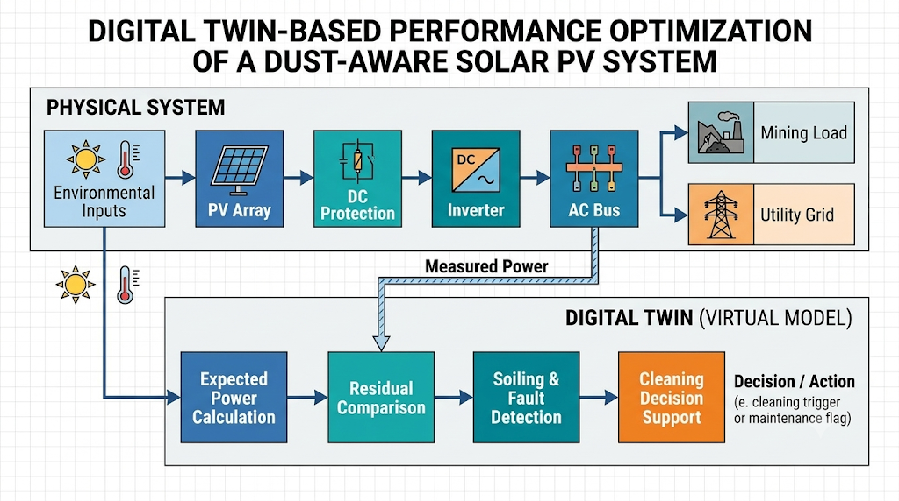

# Digital Twin-Based Performance Optimization of a Dust-Aware Solar PV System for Mining Operations
## System Architecture

### MATLAB/Simulink and SAM Simulation Study

**Developed by:**
- Pragadeesh R
- Naresh Anand D

**Department:** Electrical and Electronics Engineering  
**College:** Anjalai Ammal Mahalingam Engineering College

## Project Overview

This project focuses on optimizing the performance of a solar photovoltaic (PV) system used in mining operations through a digital twin framework.

Mining operations have continuous electrical power requirements. However, solar PV output varies with irradiance and temperature. Dust and soiling on PV panels introduce additional power losses.

The proposed digital twin compares the expected PV system performance with measured performance to identify deviations caused by soiling or possible faults. It can support performance monitoring and maintenance decisions.

## Problem Statement

- Mining operations require continuous electrical power.
- PV generation varies with environmental conditions.
- Dust accumulation reduces solar panel performance.
- Performance deviations need to be monitored for effective maintenance.

## Project Objectives

1. Model PV electrical behaviour.
2. Evaluate PV system performance.
3. Represent dust and soiling effects.
4. Use a digital twin for performance monitoring and maintenance support.

## PV System Configuration

| Parameter | Specification |
|---|---|
| PV module rating | 375 W |
| Array configuration | 18S × 37P |
| Total number of modules | 666 |
| PV capacity | 249.75 kWp |
| Inverter | 200 kW-class |
| Assumed peak demand | 220 kW |

### Power Flow

PV Array → DC Protection → Inverter → AC Bus → Mining Load / Grid

## Digital Twin Architecture

The system consists of two main parts:

**1. Physical System**
- Environmental inputs
- Physical PV system
- System measurements
- Measured power output

**2. Digital Twin Model**
- PV model
- Expected power calculation
- Residual comparison
- Soiling and fault detection
- Cleaning decision support

The difference between expected and measured PV power provides the diagnostic signal for monitoring system performance.

## Software and Tools

- MATLAB
- MATLAB/Simulink
- System Advisor Model (SAM)

## Simulation Results

### MATLAB/Simulink
- PV electrical response under environmental variation.
- I–V curve analysis under different irradiance conditions.
- P–V curve analysis under different temperature conditions.
- PV power loss due to soiling.
- Expected versus measured PV power comparison.
- Digital twin residual and cleaning decision analysis.

### SAM Results

| Parameter | Result |
|---|---:|
| Performance Ratio | 97.4% (Approximated) |
| Specific Yield | 563 kWh/kW |
| Capacity Factor (DC) | 6.4% |
| Annual AC Energy | 138,649 kWh/year |

*Note: These values are reported simulation results from the project presentation.*

## Conclusion

The project combines MATLAB/Simulink PV modelling, SAM-based annual performance evaluation, and a digital twin framework.

The digital twin compares expected and measured PV behaviour to support dust-related performance monitoring and maintenance decisions in mining operations.

## Future Work

- Site-specific weather data integration.
- Field validation of simulation results.
- Sensor and IoT integration.
- Soiling model validation.

## Project Team

- Pragadeesh R
- Naresh Anand D

**Department of Electrical and Electronics Engineering**  
**Anjalai Ammal Mahalingam Engineering College**

---
